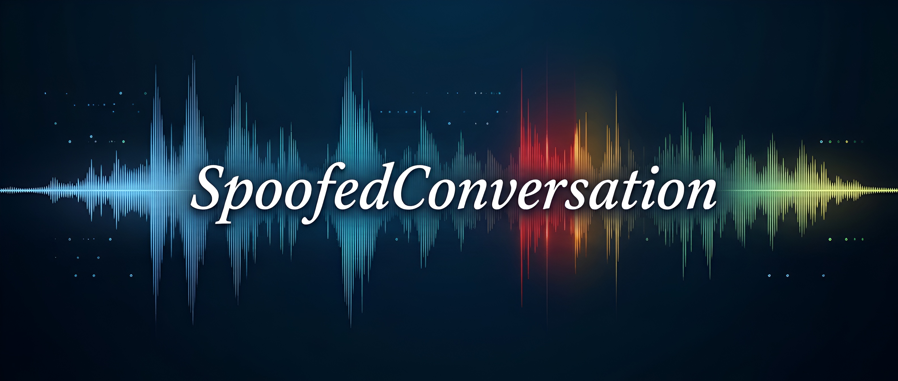
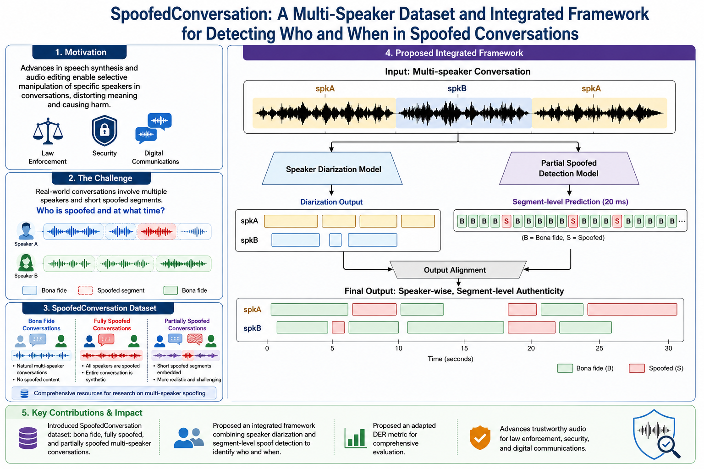

# SpoofedConversation


This is the repository of **SpoofedConversation** ("Spoofed Audio Detection in Multi-Speaker Conversations: A Dataset and Parallel Modular Diarization-Detection Pipeline") that will be published in the ROCLING 2026 conference proceedings and included in the ACL Anthology.

## 🔍 Overview
Modern speech synthesis makes it possible to alter a recording by changing only one speaker's turns. Most spoofing research, however, only focus on single-speaker audio, so the more realistic question *who spoofed when* remains largely open.

> *who spoofed when* asks which speaker is altered, and when it occurs in the audio.

<figure style="text-align: center;">
  
  <figcaption>Figure 1: Graphical Abstract of SpoofedConversation.</figcaption>
</figure>

This work makes three contributions:
- **SpoofedConversation (SC)** — a dataset of bona fide, fully spoofed, and partially spoofed multi-speaker conversations, derived from [LlamaPartialSpoof (LPS)](https://github.com/hieuthi/LlamaPartialSpoof).
- **Parallel Modular Pipeline** that pairs speaker diarization with segment-level (20 ms) spoof detection to localize spoofed regions and attribute them to a speaker.
- **Adapted Diarization Error Rate (ADER)** — an adapted metric that jointly scores both speaker attribution and spoof detection errors within a single evaluation framework.

## 📢 Updates
As I'm maintaining this work on my own under my advisor's supervision, I'll gradually update this repository. It may take some time, but I'll do my best to keep it updated.

* 2026-10-25: Released helper functions and scripts used in this work, and LPS dataset (extended).
* 2026-11-22: Released metrics: WER, EER, SegmentEER, and ADER.

## 📁 Repository Structure
```
.
├── helper/
│   ├── audio_helper.py             # helper functions for computing dataset statistics
|   ├── manipulation_helper.py      # helper functions for audio content manipulation (extending LPS dataset)
|   └── tts_log_helper.py           # helper functions for reading log from TTS generation
├── lps_dataset/
|   ├── spk_lst/                    # speaker list per split
|   ├── stats/                      # statistics per split
|   ├── transcripts/                # transcripts per class per split
|   └── llama_dataset.sh            # script to download LlamaPartialSpoof dataset
├── metrics/
|   ├── examples/                   # some data for evaluation
|   ├── adapted_der.py              # ADER
|   ├── compute_wer.py              # WER 
|   ├── eer.py                      # EER
|   ├── evaluate_segment_eer.sh     # Shell command to run segment_eer.py
|   ├── rttm_tool.py                # some tools for RTTM files
|   └── segment_eer.py              # segmentEER; to evaluate an output across different resolutions
└── scripts/
    ├── output_alignment/
    |   └── output_alignment.py     # Output alignment algorithm
    ├── downsample.py               # Resample a directory of wavs to 16 kHz mono
    ├── transcribe.py               # Batch-transcribe generated audio (Whisper large-v3)
    ├── transcripts_modification.py # Audio content manipulation for extending LPS dataset
    ├── trim_silence.py             # Trim leading/trailing non-speech with Silero VAD
    └── tts_generate.py             # Synthesize utterances with the supported TTS/VC systems
```

## 📚 Citation
Citing every work and idea used in this work would make this README too long, so only some core ideas/codebases used in this work will be cited here.

```
@article{10003971,
  author={Zhang, Lin and Wang, Xin and Cooper, Erica and Evans, Nicholas and Yamagishi, Junichi},
  journal={IEEE/ACM Transactions on Audio, Speech, and Language Processing}, 
  title={The PartialSpoof Database and Countermeasures for the Detection of Short Fake Speech Segments Embedded in an Utterance}, 
  year={2023},
  volume={31},
  number={},
  pages={813-825},
  doi={10.1109/TASLP.2022.3233236}}
```

```
@misc{luong2025llamapartialspoofllmdrivenfakespeech,
      title={LlamaPartialSpoof: An LLM-Driven Fake Speech Dataset Simulating Disinformation Generation}, 
      author={Hieu-Thi Luong and Haoyang Li and Lin Zhang and Kong Aik Lee and Eng Siong Chng},
      year={2025},
      eprint={2409.14743},
      archivePrefix={arXiv},
      primaryClass={eess.AS},
      url={https://arxiv.org/abs/2409.14743}, 
}

@misc{zhang2023rangebasedequalerrorrate,
      title={Range-Based Equal Error Rate for Spoof Localization}, 
      author={Lin Zhang and Xin Wang and Erica Cooper and Nicholas Evans and Junichi Yamagishi},
      year={2023},
      eprint={2305.17739},
      archivePrefix={arXiv},
      primaryClass={cs.SD},
      url={https://arxiv.org/abs/2305.17739}, 
}
```

## 📄 License

This project is mainly licensed under the Apache License 2.0. Each directory in this project may contain their corresponding license according to the external libraries used.
